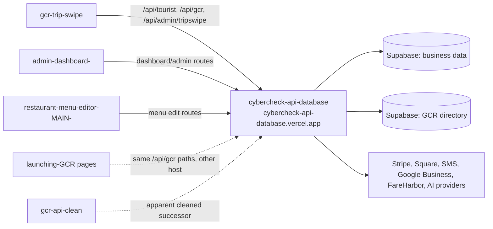

# cybercheck-api-database

The legacy Express API behind the CyberCheck business dashboards, the Gulf Coast Radar directory and the Trip Swipe tourist app, plus a large pile of data-cleanup scripts and exports.

## What it is

One Node/Express server that many front ends call: business dashboards (bookings, menus, reviews, texts, payments), a public local-business directory, a tourist app API and an admin API. The rest of the repo is not server code: hundreds of one-off `check-*`, `import-*`, `find-*`, `dedupe-*` scripts, scraped menus, photos, and JSON/CSV/XLSX exports used to build the directory data.

## How it works

- `server.js` is the entry point (Express 4, exported for Vercel). It mounts the files in `routes/` (36 files, about 900 handlers), for example:
  - `/api/auth`, `/api/dashboard`, `/api/admin`, `/api/user`, `/api/links`
  - `/api/public` (resolved per domain by `middleware/domain.js`)
  - `/api/gcr` (public directory search, detail, AI chat)
  - `/api/tourist`, `/api/tourist/groups`, `/api/tourist-auth`
  - `/api/stripe`, `/api/square`, `/api/sms`, `/api/qr`, `/api/reviews`, `/api/rides`
  - `/api/integrations/fareharbor`, `/api/google-business`, `/api/charter`, `/api/boat-rental`, `/api/photographer`
  - `/api/simple` (slug-based menu editor) and `/api/update` plus `/update` (mobile update links)
- Two Supabase clients: `db.js` (business data) and `gcr-db.js` (directory data: entity, menu, photo, event and tourist tables).
- `middleware/auth.js` verifies JWTs for protected routes.
- `vercel.json` deploys `server.js` with `@vercel/node` and defines 8 cron jobs (SMS reminders, waiver reminders, daily menu prompts, QR digests, review sends, and more).
- SQL lives in `supabase/` (numbered files), `migrations/`, and several overlapping "master schema" files at the repo root, whose run order is not documented.
- `agents/`, `tools/` and `lib/` hold health-check, scraping and helper code. `CLAUDE.md` has a route map.

## Run it

```bash
npm install
npm start        # node server.js
```

Required environment variable names: `SUPABASE_URL`, `SUPABASE_SERVICE_KEY`, `JWT_SECRET`, and for the directory routes `GCR_SUPABASE_URL`, `GCR_SUPABASE_KEY`. Payments, SMS, email, Google Business, FareHarbor and AI routes need their own provider variables (see `.env.example`, which is incomplete). Not started or tested as part of writing this README.

## Status

In use: the big legacy production API that other repos call, bundled with a lot of one-off data scripts and exports.

## Where it fits



## Related repos

- gcr-trip-swipe: uses this API as its default base URL.
- launching-GCR: calls the same `/api/gcr/*` paths on a different deployment; older docs still name this host.
- Api-layer-: a smaller copy of the entity endpoints on a different database.
- restaurant-menu-editor-MAIN- and admin-dashboard-: replacement front ends for parts of `routes/menu-edit.js`, `simple-menu-edit.js`, `update-link.js`, `dashboard.js` and `admin.js`.
- gcr-api-clean: appears to be the cleaned successor (inferred from its own notes).
